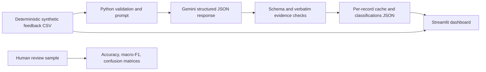

# LLM Systems Framework: Voice of Customer Analytics


[](https://github.com/laura-rivera-sancho/llm-systems-framework/actions/workflows/ci.yml)

An offline-first demonstration of how an LLM can turn unstructured B2B SaaS feedback into structured customer experience signals. The included feedback and action tracker are synthetic; all example patterns are for demonstrating the workflow and do not represent real customers or business findings.

## Portfolio review path

| What to assess | Start here | What it demonstrates |
|---|---|---|
| Portfolio scope | [Roadmap](ROADMAP.md) | What is complete and what remains before a fuller case study |
| Business framing | [Business case and value hypothesis](docs/business_case.md) | Decision context, potential value, operating boundaries, and evidence needed for a pilot |
| Architecture | [Architecture at a glance](#architecture-at-a-glance) | Data flow, model boundary, validation, and dashboard |
| Reproducibility | [Quick start](#quick-start) | Offline setup, optional inference, and dashboard launch |
| Evaluation | [Evaluation and reliability](#evaluation-and-reliability) | Blind human review, metrics, evidence checks, and limitations |
| Implementation details | [Repository map](#repository-map) | Where pipeline, dashboard, data, and tests live |

## Portfolio business case

Support, survey, onboarding, and product feedback can be difficult to compare consistently. This project demonstrates a bounded workflow for structuring fictional feedback into reviewable signals and suggested follow-up. It is a portfolio prototype—not evidence of customer impact, operational savings, or production model quality.

The detailed [business case](docs/business_case.md) sets out the decision context, a testable value hypothesis, operating risks, and evidence a real pilot would need. It deliberately separates that hypothesis from the synthetic demonstration results.

## Business problem

Customer feedback arrives through support tickets, surveys, product requests, onboarding, and customer success conversations. This project standardizes that feedback into sentiment, a controlled category, a specific theme, an evidence-supported root-cause hypothesis, urgency, and a next action. The resulting fields can help teams spot recurring friction and coordinate follow-up. They should inform investigation, not replace customer research or operational judgment.

## Architecture at a glance



The pipeline uses small Python modules and files rather than a database, agent framework, or retrieval system. The dashboard works immediately from the saved CSV and can display classifications after the optional API pipeline has run.

See the [roadmap](ROADMAP.md) for the current completion gates. This project intentionally does not claim a validated business case: the source records are synthetic and only five cases currently have human labels.

## Milestones

| Milestone | Status | Outcome |
|---|---|---|
| Synthetic data and offline dashboard | Complete | Deterministic fictional data and an API-independent dashboard |
| Gemini classification pipeline | Complete | Structured output, evidence checks, resumable cache, and usage logging; 120/120 saved records validate |
| Human-review workflow | Implemented; pilot only | Blind worksheet and scoring exist; five labeled cases are not sufficient for quality claims |
| Full portfolio case study | Not started | A business-case/value-hypothesis draft exists; a stakeholder readout still needs reviewable evaluation evidence and explicit limitations |
| Publication packaging | Pending | The empty public repository exists; Git setup, final secret scan, file allowlist, and approval before the first push remain |

## Dataset design and limitations

`data/synthetic/feedback.csv` contains 120 deterministic fictional records. The generator spans six feedback sources, three customer segments, five product areas, a date range, survey scores, and ten issue categories. The survey score rosters are seeded and reproducible, with varied CSAT 1–5 and NPS 0–10 responses; they are assigned separately from comment text and are not responses from actual customers. Scenario language repeats by design so the sample is useful for reproducible demos and tests. Records are balanced and templated; observed rates, themes, and trends must not be generalized to a real business. The output does not include generator category seeds, so they cannot be mistaken for human labels or evaluation truth.

## Model and classification

The default model is `gemini-3.1-flash-lite`, configurable with `GEMINI_MODEL`. Only the customer comment is sent to Gemini; identifiers, survey scores, and other source metadata stay local. The prompt requests JSON matching a response schema and uses a controlled category/sentiment/priority vocabulary. Root cause must be marked `Not stated` when evidence is insufficient. Supporting evidence must be a verbatim span of the original comment; invalid evidence is rejected. The classifier does not use survey scores or metadata as proof of an unstated cause.

Each successful feedback ID is cached as JSON under `data/cache/`. The pipeline validates existing output checkpoints, retries transient errors with exponential backoff and jitter, writes atomically after each record, and resumes without repeating completed classifications. It processes records serially with an 8-second minimum between API attempts by default (`GEMINI_MIN_REQUEST_INTERVAL_SECONDS`); a quota response is checkpointed and stops the run. Active Gemini quotas are model- and project-specific and should be checked in AI Studio. `data/processed/api_usage.jsonl` records request status, latency, model, and token usage without storing comment text or credentials. Set the optional input and output USD-per-million-token rates in `.env` to calculate an estimate; rates are intentionally not hard-coded and estimates do not represent provider billing.

### Completed inference snapshot — 2026-10-13

The saved batch contains **120 valid classifications for 120 input records** using `gemini-3.1-flash-lite`. The independent validator found no missing, extra, duplicate, failed, or invalid rows; the evidence audit found 120 source-grounded excerpts. The initial fast burst encountered 429 rate-limit responses, and the slower resumed run also saw transient 503 responses. Those errors were retried or resumed; no records remain failed or unclassified. Requests were kept sequential, and no billing changes or model changes were made. Google notes that active RPM/TPM/RPD limits vary by model and project and are shown in [AI Studio](https://ai.google.dev/gemini-api/docs/rate-limits).

The usage ledger contains **145 request events** for 117 record IDs: 135 responses and 10 failed attempts, with 23,668 input tokens and 14,025 output tokens recorded. Some IDs have multiple ledger events; the event file does not identify the cause of every repeat, so this count is API activity, not unique classifications. The three earlier smoke-test requests predate the ledger and are not included. No cost estimate was recorded because per-token rates were not configured.

## Quick start

Python 3.11+ is recommended. From the repository root:

```powershell
py -m venv .venv
.\.venv\Scripts\Activate.ps1
python -m pip install -r requirements.txt
Copy-Item .env.example .env
```

Add your own Gemini key to `.env`; never commit that file. `.env`, `.venv`, Python caches, and Streamlit secrets are ignored by Git. Generate or restore the deterministic data and refresh the review worksheet (saved labels for unchanged sample IDs are preserved):

```powershell
python -m src.generate_synthetic
python -m src.run_pipeline --make-review-sample --limit 0
```

The pipeline is pinned to `gemini-3.1-flash-lite`. Process the full input sequentially, or use `--limit N` for a bounded run. Successful outputs are checkpointed and reused on the next invocation:

```powershell
python -m src.run_pipeline
```

Optional live connection check: `python test_gemini.py` makes one Gemini API request. `python list_models.py` lists models available to the configured key. Neither command is part of the automated test suite.

Run the dashboard without model inference:

```powershell
streamlit run app/streamlit_app.py
```

The dashboard reads `data/processed/classifications.json` when it exists. It remains usable without an API key or model output.

## Analytics and business interpretation

The dashboard summarizes feedback volume, sentiment, themes, monthly volume, segment differences, product/journey issue categories, high-priority follow-ups, and an illustrative action tracker. Survey-source rows include separately generated synthetic survey ratings: CSAT uses a 1–5 scale and NPS uses a 0–10 scale. Ratings are not inferred from comments. The dashboard reports average CSAT, top-two-box (ratings 4–5), NPS, promoter/passive/detractor shares, response counts, and score distributions. NPS is calculated as promoter share (scores 9–10) minus detractor share (0–6); passives score 7–8. In the current 20-response subsets, CSAT averages **3.8/5** with a **65%** top-two-box rate; NPS is **+20** (50% promoters, 20% passives, 30% detractors). These are illustrative outputs from deliberately constructed data, not observed business results. The action tracker is a mock example, not evidence that any customer has been contacted or any issue has been resolved.

## Evaluation and reliability

The labeling guide is in `data/evaluation/README.md`; the 30-row worksheet is `data/evaluation/human_review_sample.csv`. Its sample is seeded and balanced by source and segment. Survey ratings are omitted from the blind worksheet so they cannot anchor sentiment or category labels. The separate prediction export is `data/evaluation/model_predictions.csv`. Five of the 30 rows currently have human labels for both fields. The resulting pilot comparison scored sentiment at **80% accuracy** and **0.381 macro-F1** (n=5; two classes represented), and category at **100% accuracy** and **0.200 macro-F1** (n=5; two of ten declared classes represented). These are preliminary, highly limited results—not reliable estimates of overall model quality. One disagreement is recorded for `VOC-0117` (human Negative vs. Gemini Mixed). `data/evaluation/codex_ai_category_review.csv` contains a separate fresh comment-based category annotation for all 30 cases; it is not human ground truth. When more human labels are added, run `python -m src.run_evaluation`; it recalculates accuracy, macro-F1, confusion matrices, class support/coverage, and excluded rows, and writes a disagreement file for qualitative review. Macro-F1 averages over the declared label set and assigns zero to classes with no true or predicted examples; report sample size and class coverage with each score.

The `supporting_evidence` field is checked against each source comment on ingestion and can be audited in saved outputs with `python -m src.qualitative_review`. Empty evidence means the output lacks a supporting excerpt; a nonmatching excerpt is flagged. Run `python -m src.validate_results` to verify complete coverage and schema-valid outputs without making API calls. Inspect false positives and false negatives by category, sentiment, segment, source, and ambiguous wording before using results operationally. Add a human escalation queue for low-confidence or contradictory cases before production use; the MVP does not ask the model to invent a numeric confidence score.

Operational reliability is kept observable through structured error messages, cached outputs, partial writes, retry behavior, configurable timeouts, and the local usage ledger. Monitor request count, token volume, configured cost estimates, cache hit rate (uncached IDs versus saved cache files), API latency, 429 errors, and output validation failures. The project does not send telemetry to an external service. Avoid placing personal, financial, health, authentication, or other sensitive data in prompts; use synthetic or properly de-identified text and follow the provider's current data handling terms.

## Tests

```powershell
python -m pytest
```

Tests cover deterministic dataset creation, evidence validation, resumable checkpoints, stratified blind sampling, separate prediction export, evaluation metrics, and usage logging. They do not call Gemini and do not assert model quality.

## Limitations and next steps

- Synthetic, repeated feedback is not representative of real customer language or prevalence.
- Classification quality has only a five-row-per-field pilot comparison against human labels; the sample is too small and category coverage too narrow to support broad quality claims.
- The model can still make plausible but incorrect categories or priorities; review evidence and errors before action.
- Root causes are hypotheses and require product or operational investigation.
- There is no multi-reviewer agreement analysis, dashboard authentication, persistent action workflow, or external monitoring.
- Before using real feedback, define retention/access controls, remove sensitive fields, review data processing requirements, and evaluate on a representative human-labeled set.

## Repository map

```text
app/streamlit_app.py            Streamlit dashboard
data/synthetic/                 Fictional input and example tracker
data/evaluation/                Blind worksheet, separate predictions, and labeling guide
src/classification.py           Gemini prompt, schema checks, retries, cache
src/evaluation.py               Blind sampling and human-reviewed metrics
src/generate_synthetic.py       Deterministic data generator
src/run_pipeline.py             CLI pipeline
src/run_evaluation.py           Prediction export and evaluation CLI
src/validate_results.py         Offline coverage/schema validation
src/qualitative_review.py       Evidence-grounding audit summary
tests/                          Deterministic offline tests
test_gemini.py                  Explicit, one-request Gemini smoke check
list_models.py                  Explicit Gemini model-list utility
```

## Portfolio relationship

This project complements the portfolio's [data architecture framework](https://github.com/laura-rivera-sancho/data-architecture-standard-framework) and [machine learning framework](https://github.com/laura-rivera-sancho/machine-learning-standard-framework). It focuses on LLM-assisted text classification and human evaluation; it does not replace governed data-platform design or a validated production ML workflow.

## License and citation

The code is available under the [MIT License](LICENSE). Citation metadata is in [CITATION.cff](CITATION.cff); publication remains pending until the final file allowlist and first-push approval are confirmed.
