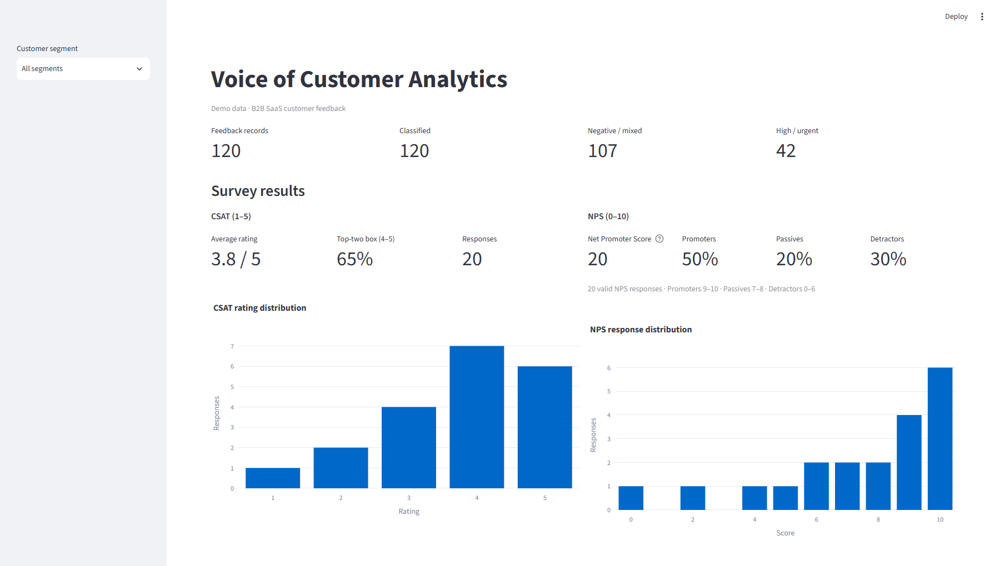

# Stakeholder readout: Voice of Customer triage prototype

## Decision question

Could a language model help a B2B SaaS team create a consistent, reviewable first-pass structure for customer feedback, while keeping a person responsible for interpretation and action?

This repository demonstrates a workflow for exploration. It is not a recommendation to automate customer decisions or route real cases without review.

## What was built

- A reproducible dataset of 120 fictional feedback records.
- A Gemini pipeline that classifies comment text into controlled fields, checks response structure and supporting evidence, caches successful results, and can resume after interruption.
- A Streamlit dashboard for feedback themes, sentiment, segments, follow-ups, and separately generated synthetic survey ratings.
- A seeded 30-record review sample and a separate prediction export. Both contain the same feedback IDs so reviewers can compare them after completing the blind worksheet.

## Dashboard preview

This is a static screenshot of the local Streamlit app using the bundled synthetic data; it is not a hosted or live dashboard. To interact with the dashboard, follow the [README quick start](../README.md#quick-start).

## Demonstration readout

All 120 synthetic records have saved, schema-valid classifications, and the supporting excerpts match their source comments. In this intentionally constructed sample, 20 survey records have separate synthetic ratings: average CSAT is **3.8/5**, top-two-box is **65%**, and NPS is **+20**. These values demonstrate dashboard calculations; they are not observed customer satisfaction or business performance.

Five records currently have labels in the review worksheet. The small pilot comparison reports sentiment accuracy **80%** and macro-F1 **0.381**, and category accuracy **100%** and macro-F1 **0.200**. Only two sentiment classes and two of ten categories are represented. These metrics are descriptive of five reviewed rows only and must not be generalized to model quality.

## Interpretation and limits

The dataset is balanced and templated, with repeated scenario language. Its category and sentiment distributions cannot estimate customer prevalence or reveal real product priorities. There is no real-customer impact measurement, manual triage baseline, reviewer-time study, or evidence that this prototype reduces effort or improves decisions. Root-cause fields are hypotheses, not verified explanations.

The dashboard should be read as an analyst exploration surface. A reviewer should open the original comment, verify the quoted evidence, correct the model output where needed, and decide whether any follow-up is appropriate. The prototype has no production access controls, persistent case workflow, or external monitoring.

## Recommendation and next evidence

Keep the workflow in a synthetic-data demonstration state. Before a real pilot, define privacy and retention controls, the triage decision and taxonomy owners, escalation rules for high-impact categories, a manual fallback, and rollback thresholds. Then compare against the current process using a representative human-labeled sample with independent reviewers, sufficient class coverage, and measured reviewer effort. Report error rates and uncertainty by class and segment before drawing any operational conclusion.

For the business hypothesis and operating risks, see the [business case](business_case.md). For the blind-labeling and metric definitions, see the [evaluation protocol](../data/evaluation/README.md).
